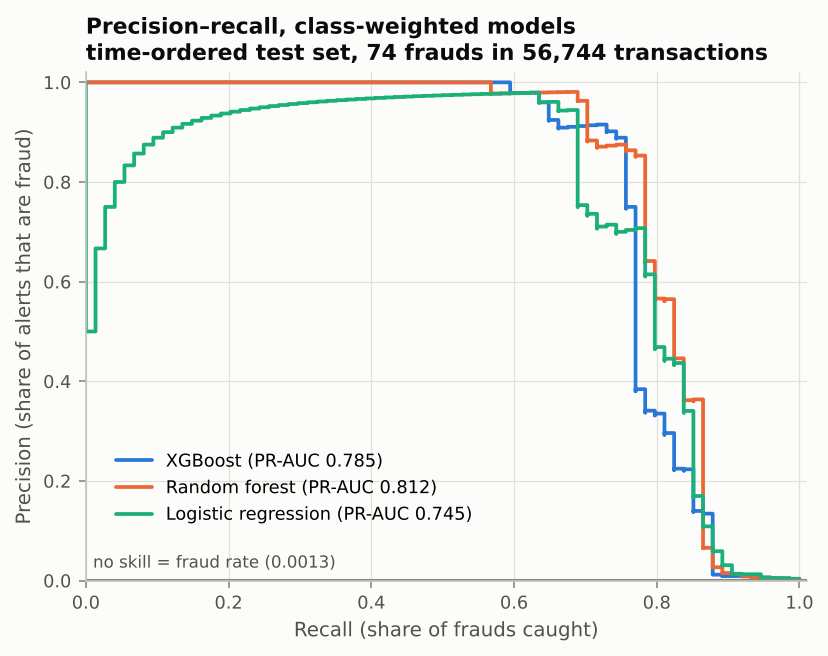
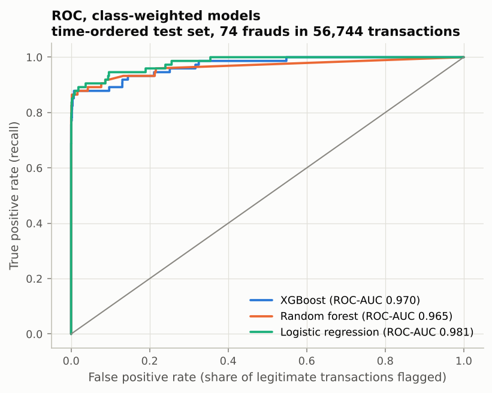
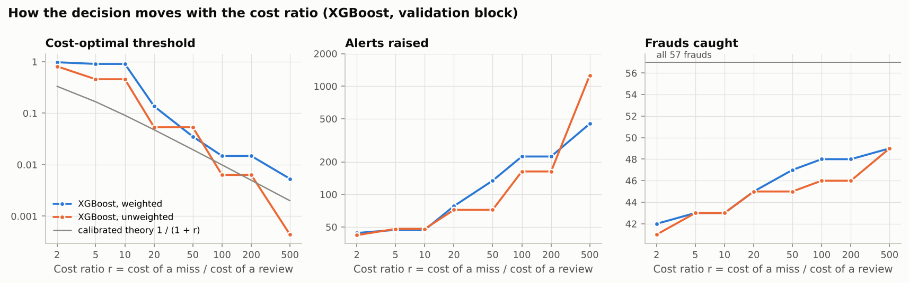

# Credit Card Fraud Detection

**Imbalanced classification with cost-based alert thresholds and time-ordered validation**
Python · pandas · scikit-learn · XGBoost · FastAPI

Only about 0.17% of the transactions in the public ULB credit-card dataset are fraud, so a model that never flags anything is 99.83% accurate and catches nothing. This project treats fraud detection as a decision problem: rank transactions by risk, then decide which ones go to manual review by weighing the cost of a missed fraud against the cost of a false alert. It compares logistic regression, random forest and XGBoost, and checks every result on a time-ordered split (train on earlier transactions, test on later ones) as well as the usual stratified split.

## Highlights

- **A metric that sees false alerts.** Models are compared on PR-AUC (average precision). ROC-AUC is reported next to it and, on the time-ordered test block, ranks the three class-weighted models in exactly the opposite order: logistic regression first on ROC-AUC (0.981) and last on PR-AUC (0.745). Its false-positive rate divides by every legitimate transaction, over 99.8% of the data, so hundreds of false alerts barely move it.
- **Thresholds from costs, not 0.5.** The alert threshold minimises `C_miss × missed frauds + C_review × false alerts` on validation data only, and a sweep shows how far it moves as a miss goes from 2 to 500 times the cost of a review.
- **Class weights and thresholds act on the same decision, for XGBoost.** With and without class weights, XGBoost's validation PR-AUC differs by +0.009 (95% CI -0.006 to +0.026) while its cost-optimal threshold moves from 0.053 to 0.136, and both thresholds catch 45 of 57 validation frauds. Logistic regression is the exception: there the weights change the ranking itself.
- **Evaluation that holds up.** Duplicates removed before splitting, scaling inside pipelines, thresholds never chosen on test data, 95% bootstrap intervals and paired model comparisons, and 35 tests, including one that recomputes every threshold from the selection scores alone.

## Results

| Model (class-weighted) | PR-AUC, time-ordered test (95% CI) | ROC-AUC, time-ordered test | PR-AUC, stratified test (95% CI) | PR-AUC, 5-fold CV (mean ± SD) |
|---|---|---|---|---|
| Logistic regression | 0.745 (0.637–0.859) | 0.981 | 0.679 (0.584–0.786) | 0.739 ± 0.025 |
| Random forest | 0.812 (0.726–0.890) | 0.965 | 0.812 (0.736–0.884) | 0.844 ± 0.037 |
| XGBoost | 0.785 (0.693–0.868) | 0.970 | 0.821 (0.750–0.890) | 0.854 ± 0.035 |
| Random guessing | 0.0013 | 0.500 | 0.0017 | 0.0017 |

The full tables, including the unweighted models, are in [`reports/results.md`](reports/results.md) and the [project documentation](docs/PROJECT_DOCUMENTATION.md#11-results).

**In plain terms:** on the time-ordered test block (56,744 transactions, 74 frauds), XGBoost at the threshold chosen on validation, with a missed fraud costed at 20 reviews, catches **57 of 74 frauds with 35 false alerts**. Random forest ranked frauds better on that block (PR-AUC 0.812 against 0.785), but XGBoost was ahead on the validation block, where the choice was made, and on the stratified split, so the two are best read as tied at the top.

<p align="center">
  
  
</p>
<p align="center">
  
</p>

## Quick start

```bash
git clone https://github.com/shubham1561/credit-card-fraud-detection.git
cd credit-card-fraud-detection
python -m venv .venv
.venv\Scripts\activate            # Windows; on macOS/Linux: source .venv/bin/activate
pip install -r requirements.txt   # or requirements-lock.txt for the exact versions behind reports/
```

Get the data, either from the public mirror the reports were produced from:

```bash
python -m src.data --download     # saves data/raw/creditcard.csv (103 MB) and checks it
```

or from [Kaggle](https://www.kaggle.com/datasets/mlg-ulb/creditcardfraud) into `data/raw/`, then `python -m src.data` to check it. Then:

```bash
python -m src.train --protocol time      # time-ordered 60/20/20 split; also saves the API's model (~8 min)
python -m src.train --protocol random    # stratified 80/20 split + 5-fold CV (~45 min)
python -m src.report                     # tables in reports/results.md, figures in reports/figures/
pytest                                   # 35 tests on synthetic data, no dataset needed
uvicorn app.main:app --reload            # scoring API; try it at http://127.0.0.1:8000/docs
```

Times are for a 2-core machine; random forest is most of it.

## Live demo

On Windows, double-click **`start_demo.bat`**: it sets up the environment, downloads the data and trains the model if they're missing (first run only), starts the server and opens the demo page in your browser.

Or by hand, after `python -m src.train --protocol time` has saved the model:

```bash
uvicorn app.main:app --reload            # then open http://127.0.0.1:8000
```

On the page you enter a transaction yourself: the amount, the hour, and the anonymised features V1–V28, with sliders for the six the model relies on most. The decision (flag for review or approve), the fraud score and the calibrated probability update as you type. Buttons fill the form with a real fraud or legitimate transaction from the held-out test block (and show its true label until you edit it), and **Score all 56,744 held-out transactions** reproduces the results below live (57 of 74 frauds caught, 35 false alerts). It needs `data/raw/creditcard.csv` for those buttons. The raw API and its documentation are at `/docs`.

## How it works

1. **Data checks.** Schema and missing values are verified, and 1,081 exact duplicate rows are removed before any split, leaving 283,726 transactions and 473 frauds.
2. **Features.** V1–V28 as provided, `log(1 + Amount)`, and hour of day encoded as sine and cosine. Raw `Time` is dropped: it counts seconds from the first transaction in the file, so it can't carry over to later data.
3. **Two evaluation protocols.** (A) A stratified 80/20 split with 5-fold cross-validation on the training part. (B) A time-ordered 60/20/20 train/validation/test split, which is the headline because production only ever predicts forward.
4. **Models.** Logistic regression (standardised inside a pipeline), random forest and XGBoost, each trained with and without class weights.
5. **Threshold.** Chosen to minimise expected cost on out-of-fold (A) or validation (B) predictions. Each test set is scored once, after every choice is frozen; a test checks that every threshold can be recomputed from the selection scores alone.
6. **Checks.** Stratified bootstrap intervals, paired model comparisons, calibration (Brier score, expected vs actual frauds per score band), TreeSHAP explanations, and a money-based cost experiment.

The full write-up, including every experiment and the model card, is in [docs/PROJECT_DOCUMENTATION.md](docs/PROJECT_DOCUMENTATION.md).

## Project structure

```
credit-card-fraud-detection/
├── configs/config.yaml        # every setting the pipeline uses
├── data/raw/                  # creditcard.csv goes here (not committed)
├── docs/PROJECT_DOCUMENTATION.md
├── notebooks/
│   ├── 01_eda.ipynb           # exploration only, no model selection
│   └── 02_results.ipynb       # reads reports/, trains nothing
├── src/
│   ├── config.py              # loads the config, resolves paths
│   ├── data.py                # load, validate, de-duplicate; python -m src.data [--download]
│   ├── features.py            # build_features(), shared with the API
│   ├── splits.py              # stratified and time-ordered protocols
│   ├── models.py              # model factory, class weights on or off
│   ├── threshold.py           # exact cost curve, cost-optimal threshold, cost-ratio sweep
│   ├── evaluate.py            # PR-AUC, ROC-AUC, operating point, bootstrap, calibration
│   ├── experiments.py         # class weights vs threshold (E2), amount-based costs (E6)
│   ├── explain.py             # TreeSHAP from XGBoost's pred_contribs
│   ├── train.py               # python -m src.train --protocol {random,time}
│   └── report.py              # tables and figures from reports/metrics/
├── app/main.py                # FastAPI scoring service
├── models/                    # saved model bundle (not committed)
├── reports/
│   ├── data_checks.json       # counts, duplicates, SHA-256 of the data file
│   ├── metrics/               # one JSON per protocol
│   ├── figures/
│   ├── scores/                # saved scores (not committed)
│   └── results.md             # generated tables
├── tests/                     # pytest: core functions, end-to-end pipeline, API
├── requirements.txt           # minimum versions
├── requirements-lock.txt      # exact versions behind reports/
└── pytest.ini
```

## Limitations

- Two days of transactions from 2013: the time-ordered split tests generalisation hours ahead, not months of drift.
- V1–V28 are anonymised PCA components, so there are no card-history or merchant features, and explanations can't be phrased in business terms.
- Each test set holds only 74 to 95 frauds, so differences of a few PR-AUC points between strong models are within noise; the intervals in the results show how much.
- The costs are assumptions. The sweep shows how the decision changes as they change, and a separate experiment costs each miss at its own amount.

## Data and citation

The dataset was collected by Worldline and the Machine Learning Group of ULB. It is available on [Kaggle](https://www.kaggle.com/datasets/mlg-ulb/creditcardfraud) and [OpenML (ID 1597)](https://www.openml.org/d/1597) and is not included in this repository. The dataset page asks users to cite, among others: A. Dal Pozzolo, O. Caelen, R. A. Johnson and G. Bontempi, *Calibrating Probability with Undersampling for Unbalanced Classification*, IEEE Symposium on Computational Intelligence and Data Mining (CIDM), 2015.

## License

Code: MIT (see [LICENSE](LICENSE)). The dataset has its own terms; see the Kaggle page.
